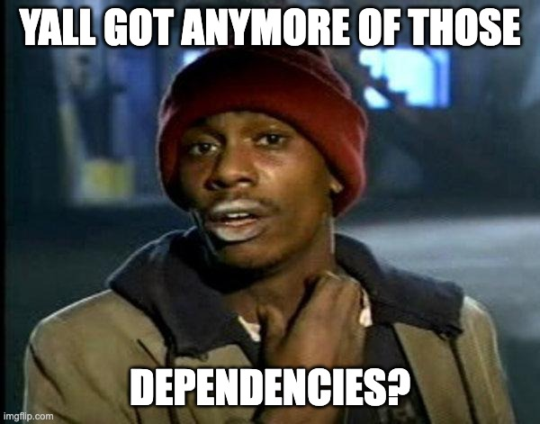

# Dependencies
## Making the right choice



---

# Three checks before you install

- 🔨 **Valid**: does it solve the problem? Could (A)I build it myself?
- ✅ **Compatible**: does it work with your Expo SDK, on iOS and Android?
  Check [React Native Directory](https://reactnative.directory/) and the
  [Expo SDK](https://docs.expo.dev/versions/latest/sdk/).
- ❤️‍🩹 **Healthy**: recent releases, open issues answered, docs, tests.
  Secure? [Shai Hulud anyone?](https://www.stepsecurity.io/blog/ctrl-tinycolor-and-40-npm-packages-compromised)

🌲 [Excalidraw Decision Tree](https://link.excalidraw.com/readonly/B3qFAd2vdrdWVlKcQFHj?darkMode=true)

---

# The agent will add dependencies

It reaches for a package the way it saw others do it. It does not know
whether that package works in Expo Go, or whether it was last updated in 2019.

- Say it in your instructions: **ask before adding a dependency**.
- Check the diff for changes to `package.json` you did not ask for.
- Every package is code you did not write and have to update. Can it be twenty
  lines of your own? Then write the twenty lines.

---

# In Expo, install like this

```bash
npx expo install <package>
```

Picks the version that matches your SDK, instead of the newest one on npm.

Needs native code and is not in the Expo SDK? Then it does not run in Expo Go.
For this course: **pick something else.**

---

# Next: exercise 1

Your own repo, your own structure, instructions updated for **your** product.

Pick your folders and move on. The names are not graded, the separation is.

`day-4/exercises/exercise-1-repo.md`
