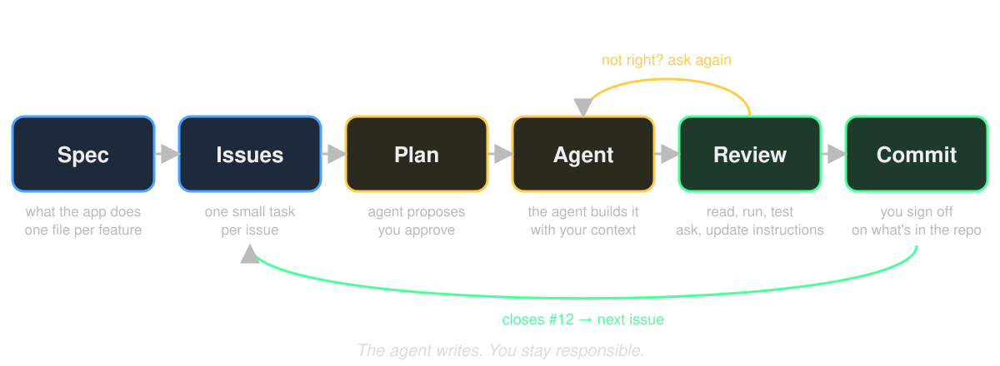

# Spec Driven Development
## You write the spec. The agent writes the code.

---



---

# What a spec is

Markdown files in your repo. Two levels.

- `specs/product.md`: what the app **is**. Goal, core action, data, out of scope. One page.
- `specs/features/<name>.md`: what the app **does**. One file per feature, 3 to 6.

Same spec as in Dan's lessons: **Goal, Constraints, Acceptance Criteria, Out of Scope**.
Every feature file becomes one issue.

It says **what** and **why**. Not how.

**No spec means the agent guesses. It guesses confidently.**

---

# Example: `specs/product.md`

```markdown
# Item catalogue

Browse the items from PokeAPI and keep a bag on the phone.

## Core action
Look up an item.

## Features
1. [Browse the list](./features/browse-list.md)
2. [Search by name](./features/search.md)
3. [The bag](./features/bag.md)

## Data
PokeAPI `/item`. The bag in SQLite (`bag` table: id, name, sprite_url, created_at).

## Technical choices
- Bag: SQLite, not AsyncStorage, because I sort it by date added.
- Data: plain `fetch` in `src/services/pokeapi.ts`, no API library. One dependency less.

## Out of scope
Accounts, prices, amounts per item, offline caching of the whole list.
```

Constraints are what the agent cannot see on its own. Out of scope is what it will not invent.

---

# One feature, one file

<style scoped>pre { font-size: 0.7em; }</style>

```markdown
# Search items by name

## Goal
Find an item by typing its name, so I do not scroll through 60 of them.

## Constraints
- On the list screen. No new screen.
- Filters the list already loaded with TanStack Query. No request per keystroke.

## Acceptance Criteria
- [ ] A search field at the top of the list.
- [ ] Typing filters the list while I type.
- [ ] No match shows "No items found".
- [ ] Clearing the field shows the full list again.

## Out of Scope
Search by type. Search history.
```

Criteria are how you and the agent both know when it is done.

---

# Vague versus sharp

<style scoped>table { font-size: 0.8em; }</style>

| Vague | Sharp |
|---|---|
| "Nice looking detail page" | "Detail shows the sprite, name, number, category and effect, the category in a badge" |
| "A bag" | "A button on the detail screen adds to SQLite, the Bag tab shows the items, still there after restart" |
| "Handle errors" | "Failed load shows the message and a Retry button that refetches" |
| "Make it fast" | "Going back to the list does not load it again: it comes from the cache" |

If you cannot tick it off, the agent cannot build it.

---

# Let the agent grill you

Your specs have holes you cannot see. Ask mode, `specs/` open:

> *Read `specs/product.md` and every file in `specs/features/`. Do not build
> anything. Ask me the questions you would need answered before you could
> build the first feature without guessing. One at a time.*

- Every answer goes **into the spec**, not just into the chat.
- A question you cannot answer is a decision you have not made. Make it, or
  move it to out of scope.
- Stop when the questions get smaller than your criteria.

---

# From feature to issue

Every feature file becomes one GitHub issue.

- Title = the feature.
- Body = a link to the feature file, then the acceptance criteria as a checklist.
- One issue is one afternoon at most. Bigger? Split it.
- The agent creates them with `gh issue create`. You check them.

**One issue, one chat.** The agent starts clean, and your history stays sorted
per issue. A chat that drifts to a second issue: stop, commit, new chat.

Issues are not admin. They are how you keep the agent on one thing at a time,
and how you prove afterwards what you did yourself.

---

# Plan first

Code is expensive to correct. A plan is ten lines.

Before the agent touches a file, it posts one comment on the issue:

- **Plan**: which files, how, what it is unsure about.
- **Tasks**: the steps as a checklist, one criterion per task.

You read it against the criteria. Wrong? Say so. Right? "Go."
While it builds, it ticks the boxes in that same comment.

Dan's `plan.md` and `tasks.md`, in one comment on the issue. Same idea, no extra files.

---

# The plan comment

<style scoped>pre { font-size: 0.7em; }</style>

```markdown
## Plan
- `src/app/(tabs)/index.tsx`: add a TextInput above the FlatList, state `query`.
- `src/components/item-list.tsx`: filter the loaded list on `query`, case-insensitive.
- Unsure: empty state, reuse `EmptyState` or new text?

## Tasks
- [ ] Search field at the top, placeholder "Search"
- [ ] Filter while typing, case-insensitive
- [ ] "No items found" on no match
- [ ] Clearing shows the full list
- [ ] Lint and tsc clean
```

The rule is in your `AGENTS.md`, so it happens every issue without asking.

---

# Commit closes the issue

```bash
git commit -m "Add search to the item list, closes #3"
git push
```

GitHub closes issue #3 and links it to the commit.

That link is evidence of how you work: the issue holds the criteria
and the plan, the commit says what happened, the chat says how it got there.

---

# Technical core

<style scoped>section { font-size: 22px; }</style>

Required for every product, whichever route you picked.

- Runs in Expo Go via QR code
- Live data from an API through TanStack Query, no key in the repo
- At least 2 screens with Expo Router
- Something stored in SQLite that survives a restart (you pick what)
- Loading state and error state on every load
- At least 1 native feature (Share, haptics, camera, notifications)
- TypeScript and ESLint without errors
- A structure where UI, data and logic are not mixed

Starter ideas add their own list on top of this. See appendix A and B in `exam/README.md`.

**The agent can build anything. It cannot choose for you.** Before you build,
write two choices in `specs/product.md` under **Technical choices**: what goes
in SQLite, and which native feature. What you picked, the alternative, and why.
Question 1 of your explanation points at them in the code.

---

# Next: exercise 2

Write `specs/product.md` and one file per feature in `specs/features/`.
Let the agent grill you, answers go into the specs. Turn every feature into an issue.

`day-4/exercises/exercise-2-spec.md`

---

# After the break: exercise 3

Your first feature, built by the agent. One issue, one chat: plan, go, review, commit with `closes #<number>`.

No slides in between. Everything you need is in the exercise.

`day-4/exercises/exercise-3-first-feature.md`
