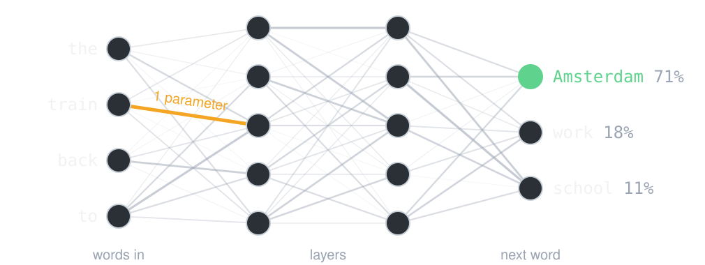
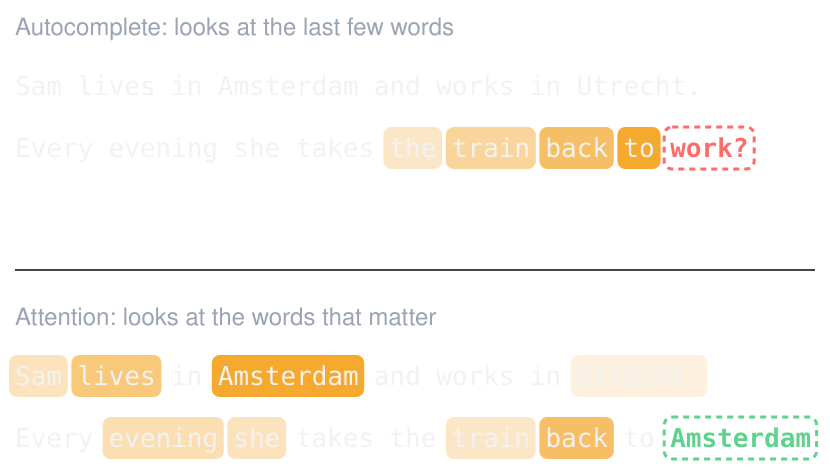
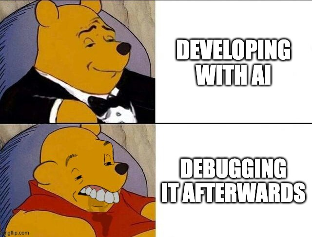

# Use of AI
## Disruptive or supporting?

---

# Poll
## Will AI replace developers?

---

# How an LLM works

It predicts the next word. Then the next one. That is all it does.

Your phone's autocomplete does that too. So why is one useless and the other
writes your app?

Two things: **what it learned**, and **what it looks at**.

---

# A neural network

- Words become numbers, go through the layers, and come out as a guess.
- Every line is a **parameter**: how strong one connection is. Billions of them.
- Same idea for photos, sound or sensor data. Language is just one.

---

# How it learns

1. Take a piece of text. Hide the next word. Let it guess.
2. Wrong? Its parameters, the lines, shift a tiny bit.
3. Repeat billions of times, until it predicts most of the text right.

It learns to say **what is written most**. Not what is **true**.

AI told me: set your heat pump's water temperature as low as possible. In my
house that backfires: the heat cannot get out, so the pump keeps switching off.
The physics is in its data too. It still repeats the popular advice from installers.

---

# Attention is all you need

[The 2017 paper](https://arxiv.org/abs/1706.03762): every word weighs every other word. Several
heads at once, each finds its own kind of link.

---

# Knowledge, not context

The agent knows the Share API by heart. Exercise 4B, day 3: did it know
**your** rules? A hex color instead of your token. A `TouchableOpacity`
instead of `Pressable`. No error handling when sharing fails.

Not because it does not know better. Because nobody told it.

Attention works on the words you give it. Name your file, your rule, your
error message: that is what it looks at. Your `AGENTS.md`, your specs and your
issues are those words.

---

# Ask for understanding

❌ *"How do I fix the Bag tab not updating?"*

✅ *"What could cause a TanStack Query list to not refresh after a mutation? List the causes, then check which one applies here."*

First ask **what plays a role**. Then ask for a solution.

A 2026 study: people who asked the AI to explain kept learning. People who let
it do all the work understood less and debugged worse.
[How AI Impacts Skill Formation](https://arxiv.org/abs/2601.20245)

---

# Who uses AI for something other than coding or homework?

---

# Beyond code: what AI is good at

- **Summarize**: a pile of house documents → the few things that matter.
- **Explain**: a client document or a new term, in plain words, at my level.
- **Check**: a heat pump quote → what is missing, what is unusual.
- **Structure**: a photo of a receipt → amounts and categories.
- **Play a role**: a client to interview, a tutor that quizzes me.

Which of these could your app use?

---

# Where it hurts

- **Confidently wrong**: it always guesses a next word, also without knowing.
- **Cognitive debt**: code that nobody in the room understands.
- **Debugging** code you did not write or read: the slowest work there is.

This is true everywhere, not only in code.

---

# Back to the poll

| Gets cheap | Stays scarce |
|---|---|
| writing code | knowing what to build, and why |
| a first design | taste and creativity |
| a first version | judging if it is right |
| doing more with fewer people | keeping it secure and running |

---

# The thesis of this course

> # _"The agent writes the code. You decide what is worth building."_

Everything in your repo is yours to explain and defend. That is also how this
course grades you.

---

# Next: exercise 3

Your first feature, built by the agent. One issue, one chat: plan, go, review,
commit with `closes #<number>`.

Give it the right words: your spec, your `AGENTS.md`, the files it may touch.

`day-4/exercises/exercise-3-first-feature.md`
